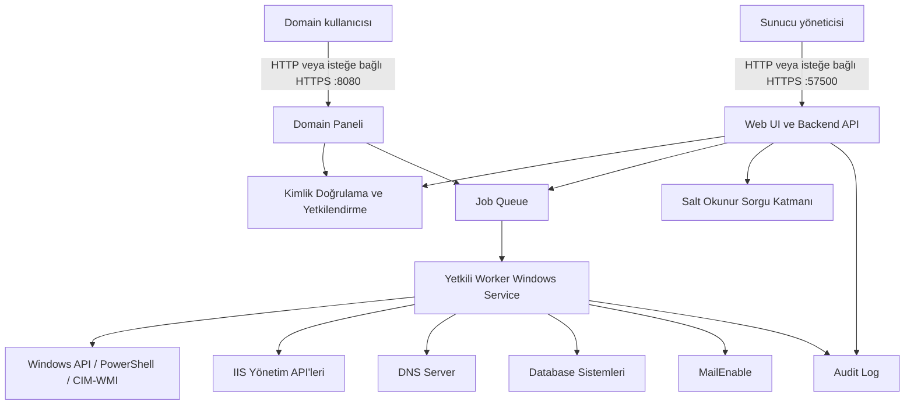

# SinX Web Tabanlı Sunucu Yönetim Uygulaması

> **Doküman sahibi:** `server_operations_specialist`  
> **Teknik koordinasyon:** `windows_server_engineer`

## 1. Doküman durumu

> **Birincil agent:** `server_operations_specialist`  
> **Destek agent'ı:** `windows_server_engineer`

- Durum: Başlangıç mimarisi ve ürün kapsamı
- Hedef platform: Windows Server
- Çalışma modeli: Uygulama, yöneteceği Windows Server üzerinde yerel olarak çalışır
- Yönetim arayüzü: Web
- Varsayılan port: `57500/TCP`
- Domain kullanıcı paneli portu: `8080/TCP`
- Varsayılan erişim: HTTP desteklenir, HTTPS zorunlu değildir
- Teknoloji ve altyapı: [Teknoloji ve Altyapı Kararları](technology-stack.md)

### 1.1 Agent kullanım kuralı

> **Birincil agent:** `server_operations_specialist`

- Her geliştirme başlığı önce bu dokümanda belirtilen birincil agent'a iletilir.
- Destek agent'ları yalnızca kendi uzmanlık sınırındaki teknik kararlara katkı verir.
- Agent'lar teknik gereksinim, risk, örnek, doğrulama ve rollback dokümantasyonu üretir; uygulama kodunu ana coding agent geliştirir.
- Ana coding agent ve repository'de değişiklik yapan diğer agent'lar [Agent Çalışma Standardı](../AGENTS.md) ile [Proje Mimarisi ve Kodlama Standardı](project-architecture.md) kurallarına uymak zorundadır.
- İş planının varsayılan sahibi ve koordinatörü `product_owner`; varsayılan implementasyon rolü `senior_fullstack_dotnet_developer` agent'ıdır. Uzman agent'lar implementasyon yapmaz ve bu rollere teknik sözleşme sağlar.
- Agent adı bir uzmanlık alanını temsil eder. Yeni üründe Plesk bulunmadığından hiçbir agent Plesk kurulumu, entegrasyonu veya bağımlılığı önermemelidir.
- Bir özellik hem sunucu hem domain kapsamına sahipse önce kapsam sahibi agent, ardından ilgili bileşen agent'ı görüş verir.

## 2. Ürün amacı

> **Birincil agent:** `windows_server_engineer`  
> **Destek agent'ları:** `server_operations_specialist`, `domain_hosting_specialist`

SinX, kurulu olduğu Windows Server üzerindeki web, DNS, veritabanı, e-posta ve işletim sistemi bileşenlerini merkezi bir web arayüzünden yönetmek için geliştirilecektir.

Uygulama uzak sunucu ekleme veya çoklu sunucu envanteri mantığıyla başlamaz. İlk sürümde yalnızca üzerinde çalıştığı yerel Windows Server'ı yönetir.

Plesk bu ürünün bir bileşeni, bağımlılığı veya kurulum seçeneği değildir.

## 3. Temel ürün kararları

> **Birincil agent:** `windows_server_engineer`  
> **Destek agent'ları:** `server_operations_specialist`, `web_server_specialist`, `web_security_specialist`

1. Uygulama IIS kurulmadan da çalışabilmelidir.
2. Web uygulaması Windows Service olarak self-hosted biçimde çalışmalıdır.
3. Uygulama `57500/TCP` portundan erişilebilir olmalıdır.
4. HTTPS desteklenebilir ancak zorunlu değildir.
5. İlk kurulum ekranında bileşen seçimi yapılmaz.
6. İlk kurulum ekranı yalnızca uygulamaya ait Windows yönetim hesabının kullanıcı adı ve parolasını ister.
7. Oluşturulan hesap yerel `Administrators` grubuna eklenir.
8. Yerleşik `Administrator` hesabı uygulama işlemlerinde kullanılmaz.
9. Aynı kullanıcı adı ve parola web paneline giriş için de kullanılır.
10. IIS, DNS, database provider'ları ve MailEnable gibi bileşenlerin kurulumu veya yönetimi kurulumdan sonra ilgili yönetim ekranlarından yapılır.
11. Bir domainin aktif web domaini olarak kullanılabilmesi için IIS kurulu ve çalışır durumda olmalıdır.
12. Bir domainin DNS zone ve kayıtlarının uygulama tarafından yönetilebilmesi için Windows DNS Server kurulu ve çalışır durumda olmalıdır.
13. Database özellikleri ürün adına sabitlenmez; provider tabanlı çalışır. İlk provider kataloğu SQL Server, PostgreSQL, MySQL ve MariaDB'den oluşur.
14. Mail özellikleri için ücretsiz [MailEnable Standard Edition](https://www.mailenable.com/standard_edition.asp) kullanılır; başka bir MailEnable edition'ı ilk ürün kapsamının zorunlu parçası değildir.
15. Eksik veya durmuş bileşenler ilk kurulum ekranında sorulmaz. Kullanıcı ilgili menüye girdiğinde `Kur`, `Aktif Et`, `Yapılandır` veya `Onar` yönlendirmesi gösterilir.
16. Her domainin web sitesi için ayrı IIS Application Pool oluşturulur ve varsayılan olarak parolasız `ApplicationPoolIdentity` kullanılır.
17. Domain panel kullanıcısı, Application Pool identity, database principal ve FTP hesabı birbirinden ayrı kimliklerdir.
18. Database erişimi domaine ve pool'a bağlı bir principal binding üzerinden sağlanır; principal başka domainlerin database'lerine yetkili olamaz.
19. SQL Server aynı sunucuda çalışıyorsa IIS pool sanal hesabı doğrudan Windows login olarak kullanılabilir. Diğer provider'larda domaine özel native database kullanıcısı oluşturulur.
20. FTP hesabı yalnızca kullanıcı isterse ayrıca oluşturulur; yerel Administrator üyesi olmaz ve yalnızca domain dizinine erişir.
21. Domain kullanıcıları `8080/TCP` üzerinden kendi domain yönetim ekranına erişir ve yalnızca bağlı oldukları `domainId` kapsamındaki işlemleri görebilir ve çalıştırabilir.
22. Domain panel hesabı uygulama hesabıdır; Windows yöneticisi, FTP hesabı veya Application Pool identity değildir.
23. Application Pool için kullanıcıdan parola istenmez. IIS tarafından yönetilen `ApplicationPoolIdentity` kullanılır.

## 4. İlk kurulum akışı

> **Birincil agent:** `windows_server_engineer`  
> **Destek agent'ları:** `server_operations_specialist`, `web_security_specialist`

### 4.1 Kurulum ön koşulu

> **Birincil agent:** `windows_server_engineer`  
> **Destek agent'ı:** `server_operations_specialist`

Uygulamanın installer'ı Windows üzerinde yükseltilmiş yönetici yetkisiyle çalıştırılmalıdır. Bu yetki, uygulamaya ait yerel hesabı oluşturmak ve Worker Service'i yapılandırmak için kullanılır.

### 4.2 İlk açılış

> **Birincil agent:** `server_operations_specialist`  
> **Destek agent'ları:** `web_server_specialist`, `web_security_specialist`

Uygulama ilk kez aşağıdaki adreste açılır:

```text
http://<SERVER_IP_OR_HOSTNAME>:57500/setup
```

Kurulum ekranında yalnızca şu alanlar bulunur:

- Kullanıcı adı
- Parola
- Parola tekrarı
- Kurulumu Tamamla düğmesi

Parola tekrarı ayrı bir kimlik bilgisi değildir; yalnızca yazım hatasını önlemek amacıyla kullanılır.

### 4.3 Hesap oluşturma

> **Birincil agent:** `windows_server_engineer`  
> **Destek agent'ları:** `server_operations_specialist`, `web_security_specialist`

Kurulum tamamlanırken sistem:

1. Kullanıcı adının Windows hesap adı kurallarına uygunluğunu doğrular.
2. Aynı isimde yerel hesap bulunmadığını kontrol eder.
3. Yeni bir yerel Windows hesabı oluşturur.
4. Hesabı yerel `Administrators` grubuna ekler.
5. Hesaba Worker Service için gerekli `Log on as a service` hakkını verir.
6. Yetkili Worker Service'i bu hesap altında çalışacak şekilde yapılandırır.
7. Servisin başlayabildiğini ve yönetim işlemi gerçekleştirebilecek yetkiye sahip olduğunu doğrular.
8. Oluşturulan hesabın değişmez Windows SID değerini uygulama yapılandırmasına kaydeder.
9. Kurulum durumunu tamamlandı olarak işaretler.
10. `/setup` endpoint'ini kalıcı olarak devre dışı bırakır.

`Administrators` grubu üyeliği, hesabın yerleşik Administrator hesabıyla aynı yerel yönetici rolüne sahip olmasını sağlar. Yerleşik hesabın kopyalanması, yeniden adlandırılması veya uygulamada saklanması gerekmez.

## 5. Giriş ve oturum yönetimi

> **Birincil agent:** `web_security_specialist`  
> **Destek agent'ları:** `windows_server_engineer`, `server_operations_specialist`

### 5.1 Giriş modeli

> **Birincil agent:** `web_security_specialist`  
> **Destek agent'ı:** `windows_server_engineer`

Web paneline girişte kurulum sırasında oluşturulan aynı Windows hesabı kullanılır:

```text
http://<SERVER_IP_OR_HOSTNAME>:57500/login
```

Giriş akışı:

1. Kullanıcı adı ve parola backend'e gönderilir.
2. Backend yalnızca kurulum sırasında kaydedilmiş Windows SID'sine karşılık gelen hesabı kabul eder.
3. Parola yerel Windows güvenlik altyapısı üzerinden doğrulanır.
4. Başarılı doğrulama sonrasında sunucu taraflı uygulama oturumu oluşturulur.
5. Parola mümkün olan en kısa süre bellekte tutulur ve hiçbir log, veritabanı veya yapılandırma dosyasına yazılmaz.
6. Sonraki isteklerde parola yerine rastgele ve süreli oturum kimliği kullanılır.

Başka bir yerel Administrator hesabı, domain hesabı veya yerleşik Administrator hesabı otomatik olarak panel giriş yetkisi kazanmaz.

### 5.2 Oturum kuralları

> **Birincil agent:** `web_security_specialist`  
> **Destek agent'ı:** `monitoring_logging_specialist`

- Oturum cookie'si `HttpOnly` ve `SameSite=Strict` olmalıdır.
- HTTPS kullanıldığında cookie ayrıca `Secure` olmalıdır.
- Başarısız girişlere uygulama katmanında rate limit uygulanmalıdır.
- Windows hesabının kilitlenmesine yol açabilecek sınırsız doğrulama denemelerine izin verilmemelidir.
- Login, logout, başarısız giriş, kilitlenme ve oturum sonlandırma olayları audit log'a yazılmalıdır.
- Kullanılmayan oturumlar belirlenen süre sonunda kapatılmalıdır.

### 5.3 Parola değişikliği

> **Birincil agent:** `windows_server_engineer`  
> **Destek agent'ları:** `web_security_specialist`, `server_operations_specialist`

Yönetim hesabının parolası panelden değiştirilirse işlem tek bir yönetilen akış olarak ele alınmalıdır:

1. Mevcut parola doğrulanır.
2. Yeni parola politikaya göre kontrol edilir.
3. Yeni yönetim job'larının başlaması geçici olarak durdurulur.
4. Yerel Windows hesabının parolası değiştirilir.
5. Worker Service'in service-logon parolası güncellenir.
6. Worker Service yeniden başlatılır ve sağlık kontrolü yapılır.
7. Başarı doğrulandıktan sonra eski parola bellekten temizlenir.
8. İşlem başarısız olursa kontrollü geri dönüş uygulanır ve sonuç audit log'a kaydedilir.

### 5.4 Domain paneline giriş ve yetkilendirme

> **Birincil agent:** `web_security_specialist`  
> **Destek agent'ları:** `domain_hosting_specialist`, `automation_api_specialist`

Her domain, oluşturma sırasında tanımlanan domain kullanıcı adı ve parolasıyla aşağıdaki panelden giriş yapar:

```text
http://<DOMAIN_NAME>:8080/login
```

- Kullanıcı adı domain kapsamında benzersiz uygulama hesabıdır; Windows hesabı oluşturmaz.
- Parola güçlü ve adaptif bir password hash ile saklanır; düz metin veya geri çözülebilir biçimde tutulmaz.
- Başarılı giriş sonrasında oturum değişmez `domainId` ve domain rol/izinleriyle bağlanır.
- `Host` header yalnızca tenant çözümlemeye yardımcı olur; yetkilendirmenin tek kanıtı değildir.
- Her API sorgusu ve komutu sunucu tarafında oturumdaki `domainId` ile sınırlandırılır. İstemciden gönderilen başka bir `domainId` kabul edilmez.
- Domain kullanıcısı `57500` yönetici paneline, sunucu menülerine veya başka domainlerin kaynaklarına erişemez.
- Bilinmeyen, pasif veya başka domaine ait host adıyla gelen istek reddedilir.
- Kullanıcı adı/parola değişikliği, başarısız girişler ve tüm yönetim işlemleri domain kimliğiyle audit log'a yazılır.

## 6. Uygulama mimarisi

> **Birincil agent:** `automation_api_specialist`  
> **Destek agent'ları:** `windows_server_engineer`, `server_operations_specialist`, `web_security_specialist`



### 6.1 Web katmanı

> **Birincil agent:** `web_server_specialist`  
> **Destek agent'ları:** `web_security_specialist`, `automation_api_specialist`

- İnternet üzerinden `57500/TCP` portunda hizmet verir.
- Domain kullanıcı arayüzü `8080/TCP` portunda ayrı endpoint olarak sunulur; sunucu yönetimi route'ları bu endpoint'te yayınlanmaz.
- Mümkün olan en düşük Windows yetkisiyle çalışır.
- Kullanıcıdan gelen ham PowerShell, shell veya SQL metnini doğrudan çalıştırmaz.
- İstekleri doğrular ve yalnızca tanımlı operasyonlara dönüştürür.

### 6.2 Yetkili Worker Service

> **Birincil agent:** `windows_server_engineer`  
> **Destek agent'ları:** `server_operations_specialist`, `automation_api_specialist`

- Kurulumda oluşturulan yerel yönetim hesabıyla çalışır.
- Yalnızca önceden tanımlanmış, tip güvenli operasyonları kabul eder.
- Web katmanıyla local-only Named Pipe veya eşdeğer korumalı IPC üzerinden haberleşir.
- Uzun süren işlemleri job olarak yürütür.
- Her işlem için önceki durum, hedef durum, sonuç ve hata bilgisini üretir.

## 7. Kapsam modeli

> **Birincil agent:** `domain_hosting_specialist`  
> **Destek agent'ı:** `server_operations_specialist`

Uygulamadaki özellikler iki temel kapsama ayrılır:

### 7.1 Sunucu kapsamı

> **Birincil agent:** `server_operations_specialist`  
> **Destek agent'ı:** `windows_server_engineer`

Sunucunun tamamını, bir Windows rolünü, servis motorunu veya tüm domainleri etkileyen özelliklerdir. Bunlar ana sol menüde yer alır.

### 7.2 Domain kapsamı

> **Birincil agent:** `domain_hosting_specialist`

Yalnızca seçili domaine bağlı web sitesi, DNS zone, mail domaini, sertifika, dosya veya database ilişkilerini etkileyen özelliklerdir. Bunlar ana sol menüye bağımsız modül olarak eklenmez; `Domainler > Domain Detayı` altında sekme olarak gösterilir.

### 7.3 Temel navigasyon kuralı

> **Birincil agent:** `domain_hosting_specialist`  
> **Destek agent'ı:** `server_operations_specialist`

> Bir ayar domain seçilmeden anlamlı değilse Domain Detayı'nda; tüm sunucuyu veya servis motorunu etkiliyorsa sol menüde yer alır.

## 8. Ekran ve menü dokümantasyonu

> **Birincil agent:** `domain_hosting_specialist`  
> **Destek agent'ı:** `server_operations_specialist`

Sol menü, Domain Detayı sekmeleri, alt ekranlar ve sunucu/domain kapsam ayrımı ayrı dokümanda tutulur:

[Ekran ve Menü Dokümantasyonu](screen-menu.md)

Bu bağlantıdaki doküman ekran hiyerarşisi için tek doğruluk kaynağıdır. Ana uygulama dokümanında ekran ağacı tekrar edilmez.

## 9. Domain veri modeli

> **Birincil agent:** `domain_hosting_specialist`  
> **Destek agent'ları:** `automation_api_specialist`, `database_integration_specialist`, `dns_specialist`, `mail_management_specialist`

Domain, yalnızca metin biçiminde bir alan adı değildir. İlgili kaynakları bir araya getiren uygulama varlığıdır.

```text
Domain
├── Identity: domainId, punycodeName, displayName
├── Network: IP ve binding ilişkileri
├── IIS: siteId, applicationPool, documentRoot
├── DNS: zoneId ve kayıtlar
├── Mail: mailDomainId ve mailbox'lar
├── Databases: providerId, instanceId ve atanmış database/user ilişkileri
├── Access: panelUserId, appPoolIdentity, databasePrincipalBindings, optionalFtpAccountId
├── Certificates: certificate thumbprint ve binding ilişkileri
├── Storage: root path ve FTP ilişkileri
├── Backups: domain kapsamlı backup job'ları
└── Observability: log filtreleri, metrikler ve uyarılar
```

### 9.1 Domain kimlik ayrımı

> **Birincil agent:** `web_security_specialist`  
> **Destek agent'ları:** `windows_server_engineer`, `web_server_specialist`, `database_integration_specialist`

| Kimlik | Amaç | Saklama/doğrulama | Yetki sınırı |
|---|---|---|---|
| Domain panel kullanıcısı | `:8080` domain paneline giriş | Uygulama database'inde güçlü password hash | Yalnızca bağlı `domainId` |
| IIS Application Pool identity | Website worker process ve NTFS erişimi | IIS sanal hesabı; parola yok | Yalnızca domain document root'u ve açıkça verilen kaynaklar |
| Database principal binding | Website'in database bağlantısı | Provider'a göre Windows-integrated veya şifreli native credential | Yalnızca atanmış database/schema |
| FTP Windows hesabı | Haricî FTP/FTPS dosya erişimi | Windows yerel hesap altyapısı | Yalnızca domain FTP root'u; Administrator değil |

Domain panel kullanıcısının parolası Windows hesabı veya IIS pool parolası olarak kullanılmaz. Application Pool identity ile database principal arasındaki ilişki uygulama metadata'sında tutulur; fakat tüm provider'ların Windows sanal hesaplarını doğrudan doğruladığı varsayılmaz.

### 9.2 Website ve Application Pool izolasyonu

> **Birincil agent:** `web_server_specialist`  
> **Destek agent'ları:** `windows_server_engineer`, `web_security_specialist`

Her website için ayrı IIS site ve Application Pool oluşturulur:

```text
Domain: example.com
Site: SinX-Site-<domainId>
Application Pool: SinX-Pool-<domainId>
Identity: ApplicationPoolIdentity
Document Root: C:\Sites\<domainId>\wwwroot
NTFS Principal: IIS AppPool\SinX-Pool-<domainId>
```

Pool sanal hesabına yalnızca kendi domain dizininde gerekli `Read & Execute` ve uygulamanın yazma ihtiyacı varsa hedefli `Modify` izni verilir. Diğer domain dizinlerinde, SinX uygulama verisinde veya sunucu genelinde izin verilmez.

### 9.3 FTP hesabı

> **Birincil agent:** `file_deployment_specialist`  
> **Destek agent'ları:** `windows_server_engineer`, `web_security_specialist`

Domain oluşturma ekranında FTP erişimi isteğe bağlıdır. Etkinleştirilirse kullanıcıdan ayrı FTP kullanıcı adı ve parolası alınır.

FTP hesabı:

- Yerel `Administrators` grubuna eklenmez.
- Application Pool identity olarak kullanılmaz.
- Domain panel kullanıcısıyla aynı hesap değildir.
- Yalnızca ilgili domainin FTP root'una NTFS izni alır.
- RDP, konsol ve service logon için kullanılmaz.
- Mümkün olduğunda IIS FTP User Isolation ile domain dizinine hapsedilir.
- FTP yerine FTPS kullanımı desteklenir ve önerilir.

URL ve API işlemlerinde değişebilen domain adı yerine uygulamanın ürettiği değişmez `domainId` kullanılmalıdır:

```text
/domains/{domainId}
/domains/{domainId}/website
/domains/{domainId}/dns-records
/domains/{domainId}/mailboxes
/domains/{domainId}/databases
/domains/{domainId}/certificates
/domains/{domainId}/backups
/domains/{domainId}/logs
```

Sunucu kapsamındaki endpoint'ler ayrı tutulmalıdır:

```text
/server/roles
/server/iis
/server/dns
/server/database-providers
/server/database-providers/{providerId}
/server/databases
/server/mail
/server/users
/server/services
/server/firewall
/server/certificates
/server/storage
/server/backups
/server/logs
/server/updates
```

## 10. Bileşen kurulumu ve keşfi

> **Birincil agent:** `server_operations_specialist`  
> **Destek agent'ları:** `windows_server_engineer` ve kurulacak bileşenin uzman agent'ı

Kurulum ekranı bileşen kurmaz. Kullanıcı giriş yaptıktan sonra uygulama sunucuyu otomatik keşfeder ve her bileşeni şu durumlardan biriyle gösterir:

- Kurulu ve çalışıyor
- Kurulu fakat durmuş
- Kısmen yapılandırılmış
- Kurulu değil
- Yeniden başlatma bekliyor
- Desteklenmiyor
- Durum doğrulanamadı

Kurulu olmayan bileşenler ilgili sunucu seviyesi modülünde `Kur` aksiyonu olarak sunulur. Örneğin IIS kurulumu `Windows Rolleri` veya `IIS Yönetimi` ekranından başlatılır; ilk kurulum sihirbazında sorulmaz.

### 10.1 Bileşen geçiş kapısı

> **Birincil agent:** `server_operations_specialist`  
> **Destek agent'ları:** `windows_server_engineer` ve hedef bileşenin uzman agent'ı

Bir özellik ekranı açılmadan önce gerekli bileşenin gerçek durumu yeniden kontrol edilir. Menüde daha önce alınmış cache bilgisi tek başına yeterli kabul edilmez.

| Algılanan durum | Kullanıcıya gösterilecek ana aksiyon | Ekran davranışı |
|---|---|---|
| Kurulu ve çalışıyor | `Yönet` | Özellik ekranı açılır |
| Kurulu fakat durmuş | `Aktif Et` | Özellik ekranı bloke edilir; servis başlatma planı gösterilir |
| Kurulu fakat eksik yapılandırılmış | `Yapılandır` | Eksik ön koşullar ve uygulanacak ayarlar gösterilir |
| Kurulum bozuk veya doğrulama başarısız | `Onar` | Teşhis sonucu ve onarım planı gösterilir |
| Kurulu değil | `Kur` | Kurulum planı ve bağımlılıklar gösterilir |
| Yeniden başlatma bekliyor | `Yeniden Başlat` | Yeni değişiklik engellenir; reboot sonrası devam bilgisi gösterilir |
| Desteklenmiyor | Aksiyon yok | Neden ve desteklenen platform/sürüm bilgisi gösterilir |
| Durum doğrulanamadı | `Tekrar Kontrol Et` | Hata ayrıntısı ve salt-okunur yeniden keşif sunulur |

Kurulum veya aktivasyon otomatik ve sessiz başlamaz. Kullanıcı önce etki planını görür ve onaylar. İşlem daha sonra yetkili Worker Service tarafından job olarak yürütülür.

### 10.2 Özellik bağımlılıkları

> **Birincil agent:** `windows_server_engineer`  
> **Destek agent'ları:** `web_server_specialist`, `dns_specialist`, `database_integration_specialist`, `mailenable_specialist`

| Özellik | Gerekli bileşen | Zorunluluk | Eksik/durmuş durumda davranış |
|---|---|---|---|
| Domain oluşturma ve aktif web sitesi | IIS Web Server | Domain web işlevi için zorunlu | Domain aktivasyonu bloke edilir; `Kur` veya `Aktif Et` gösterilir |
| Domain DNS kayıtları | Windows DNS Server | Uygulama tarafından DNS yönetimi için zorunlu | DNS ekranı bloke edilir; `Kur` veya `Aktif Et` gösterilir |
| SQL Server database işlemleri | `sqlserver` provider'ı | SQL Server özelliği kullanıldığında zorunlu | Provider ekranı bloke edilir; `Kur` veya `Aktif Et` gösterilir |
| PostgreSQL database işlemleri | `postgresql` provider'ı | PostgreSQL özelliği kullanıldığında zorunlu | Provider ekranı bloke edilir; `Kur` veya `Aktif Et` gösterilir |
| MySQL database işlemleri | `mysql` provider'ı | MySQL özelliği kullanıldığında zorunlu | Provider ekranı bloke edilir; `Kur` veya `Aktif Et` gösterilir |
| MariaDB database işlemleri | `mariadb` provider'ı | MariaDB özelliği kullanıldığında zorunlu | Provider ekranı bloke edilir; `Kur` veya `Aktif Et` gösterilir |
| Domain mail işlemleri | MailEnable Standard Edition | Mail özelliği kullanıldığında zorunlu | Mail ekranı bloke edilir; `Kur` veya `Aktif Et` gösterilir |

Database özelliği domainin var olması için zorunlu değildir. Ancak `Database Sistemleri` veya Domain Detayı içindeki `Database'ler` ekranından işlem yapılabilmesi için seçilen provider'ın desteklediği motor/servisin kurulu ve çalışır olması zorunludur.

Mail özelliği domainin web sitesi olarak var olması için zorunlu değildir. Ancak domaine mail hizmeti açılabilmesi için MailEnable Standard Edition kurulu, çalışır ve temel doğrulamaları geçmiş olmalıdır.

| Kurulum/keşif alanı | Birincil agent | Destek agent'ları |
|---|---|---|
| Windows rolleri ve özellikleri | `windows_server_engineer` | `server_operations_specialist` |
| IIS | `web_server_specialist` | `windows_server_engineer`, `application_runtime_specialist` |
| DNS Server | `dns_specialist` | `windows_server_engineer` |
| SQL Server | `sql_server_engineer` | `database_integration_specialist`, `windows_server_engineer` |
| PostgreSQL | `postgresql_engineer` | `database_integration_specialist`, `windows_server_engineer` |
| MySQL | `database_integration_specialist` | `windows_server_engineer`; provider uzmanı tanımlandığında ayrıca eklenir |
| MariaDB | `database_integration_specialist` | `windows_server_engineer`; provider uzmanı tanımlandığında ayrıca eklenir |
| MailEnable | `mailenable_specialist` | `mail_management_specialist`, `mail_security_specialist`, `windows_server_engineer` |
| Sertifika bileşenleri | `tls_certificate_specialist` | `windows_server_engineer` |
| Backup bileşenleri | `backup_restore_specialist` | `remote_backup_storage_specialist`, `windows_server_engineer` |
| Monitoring ve log bileşenleri | `monitoring_logging_specialist` | `windows_server_engineer` |

### 10.3 Database provider mimarisi

> **Birincil agent:** `database_integration_specialist`  
> **Destek agent'ları:** `sql_server_engineer`, `postgresql_engineer` ve provider'a özgü uzman agent'lar

Database yönetimi belirli ürün adlarına göre dallanan sabit ekran ve backend koduyla geliştirilmemelidir. Her database ürünü ortak bir provider sözleşmesini uygular.

İlk provider kataloğu:

| `providerId` | Görünen ad | Provider türü |
|---|---|---|
| `sqlserver` | Microsoft SQL Server | İlişkisel database provider'ı |
| `postgresql` | PostgreSQL | İlişkisel database provider'ı |
| `mysql` | MySQL | İlişkisel database provider'ı |
| `mariadb` | MariaDB | İlişkisel database provider'ı |

Her provider en az aşağıdaki metadata ve operasyon sözleşmesini tanımlar:

```text
DatabaseProvider
├── providerId ve displayName
├── Desteklenen Windows Server ve ürün sürümleri
├── Detection ve health-check kuralları
├── Kurulum, aktivasyon, onarım ve kaldırma yetenekleri
├── Instance veya service keşfi
├── Port ve bağlantı metadata'sı
├── Database yaşam döngüsü yeteneği
├── User/role yaşam döngüsü yeteneği
├── Backup ve restore yetenekleri
├── TLS ve authentication yetenekleri
├── Connection template
└── Provider-specific validation ve error mapping
```

UI sabit butonlar varsaymaz; provider'ın bildirdiği capability değerlerine göre aksiyon gösterir. Örneğin bir provider belirli bir backup veya kullanıcı yönetimi özelliğini desteklemiyorsa ilgili aksiyon gizlenir veya desteklenmiyor olarak işaretlenir.

Domain-database ilişkisi aşağıdaki kimliklerle tutulmalıdır:

```text
DomainDatabaseAssignment
├── domainId
├── providerId
├── instanceId
├── databaseId veya databaseName
├── assignedUserIds
└── connectionMetadataReference
```

Provider-specific parola, connection string sırrı ve credential değerleri bu ilişkide düz metin olarak tutulmaz.

Her kurulum işlemi başlamadan önce kullanıcıya şunlar gösterilmelidir:

- Kurulacak bileşen ve bağımlılıklar
- Değişecek Windows rolleri veya servisleri
- Açılacak portlar
- İndirilecek paketler ve doğrulama bilgileri
- Lisans gereksinimleri
- Yeniden başlatma ihtiyacı
- Doğrulama adımları
- Geri alma imkânı ve sınırları

## 11. Job sistemi

> **Birincil agent:** `automation_api_specialist`  
> **Destek agent'ları:** `server_operations_specialist`, `monitoring_logging_specialist`

Sunucuda durum değiştiren her işlem job olarak yürütülmelidir.

Örnek durumlar:

```text
Queued
Running
WaitingForReboot
Succeeded
Failed
Cancelled
RollbackRunning
RolledBack
RollbackFailed
```

Her job aşağıdaki bağlamı taşımalıdır:

- `scopeType`: `server` veya `domain`
- `scopeId`: server kimliği veya `domainId`
- İşlem türü
- Talep eden kullanıcı SID'si
- Hedef bileşen
- Ön kontrol sonucu
- Önceki ve hedef durum
- Başlangıç/bitiş zamanı
- Exit code ve güvenli hata özeti
- Doğrulama sonucu
- Rollback bilgisi

Domain Detayı'ndan başlayan job'lar mutlaka ilgili `domainId` ile ilişkilendirilmelidir. Sunucu seviyesindeki job'lar yanlışlıkla tek bir domain işlemi gibi gösterilmemelidir.

## 12. Audit gereksinimleri

> **Birincil agent:** `monitoring_logging_specialist`  
> **Destek agent'ı:** `web_security_specialist`

Audit log en az şu bilgileri içermelidir:

- İşlemi talep eden hesabın SID ve kullanıcı adı
- Zaman damgası ve zaman dilimi
- Kaynak IP ve oturum kimliği
- Sunucu veya domain kapsamı
- Hedef nesne
- İşlem adı
- Hassas değerler maskelenmiş parametre özeti
- Önceki ve yeni değer
- Onay bilgisi
- Sonuç ve job kimliği

Parola, private key, token, connection string sırrı ve mailbox içeriği audit log'a yazılmamalıdır.

## 13. Kritik işlem kuralları

> **Birincil agent:** `web_security_specialist`  
> **Destek agent'ları:** `windows_server_engineer`, `server_operations_specialist` ve hedef bileşenin uzman agent'ı

Aşağıdaki işlemler açık etki özeti ve kullanıcı onayı gerektirir:

- Windows rolü kurma veya kaldırma
- Servis restart/stop
- IIS site veya application pool durdurma
- DNS zone veya kayıt silme
- Kullanıcı/grup silme veya yetki değiştirme
- Firewall kuralı değiştirme
- Sertifika değiştirme veya kaldırma
- Database, login veya veri silme
- Mail domaini/mailbox silme
- Queue temizleme
- Backup restore
- Disk/volume işlemleri
- Windows Update ve sunucu restartı

Onay ekranı hedef kapsamı açıkça göstermelidir. Domain işlemlerinde domain adı; sunucu işlemlerinde `Tüm sunucuyu etkiler` uyarısı görünmelidir.

## 14. HTTP ve HTTPS davranışı

> **Birincil agent:** `web_security_specialist`  
> **Destek agent'ları:** `tls_certificate_specialist`, `web_server_specialist`

- HTTP kullanımı desteklenir.
- HTTPS isteğe bağlı olarak `Ayarlar` bölümünden etkinleştirilebilir.
- HTTPS bulunmaması kurulumu veya kullanımı engellemez.
- HTTP kullanıldığında kullanıcı parolası ve oturum cookie'si ağ üzerinde şifrelenmez.
- Bu risk kurulum ve ayarlar ekranında açıkça belirtilmelidir.
- Rate limit, kısa oturum süresi ve setup endpoint'inin kapatılması HTTP'nin ağ dinleme/MITM riskini ortadan kaldırmaz.

## 15. İlk geliştirme sırası

> **Birincil agent:** `server_operations_specialist`  
> **Destek agent'ları:** Her geliştirme adımının yanında belirtilmiştir.

1. Windows Service host ve `57500` portu — `windows_server_engineer`, `web_server_specialist`
2. İlk kurulum durumu ve hesap oluşturma ekranı — `windows_server_engineer`, `server_operations_specialist`, `web_security_specialist`
3. Yerel Windows hesabı, Administrators üyeliği ve Worker Service yapılandırması — `windows_server_engineer`
4. Windows hesabıyla login ve oturum yönetimi — `web_security_specialist`, `windows_server_engineer`
5. Server Dashboard ve salt-okunur sistem keşfi — `monitoring_logging_specialist`, `windows_server_engineer`
6. Job ve audit altyapısı — `automation_api_specialist`, `monitoring_logging_specialist`
7. Bileşen durum motoru ve `Kur / Aktif Et / Yapılandır / Onar` geçiş kapısı — `server_operations_specialist`, `windows_server_engineer`
8. Domain veri modeli ve Domain listesi — `domain_hosting_specialist`, `automation_api_specialist`
9. IIS server-level görünümü ve zorunlu IIS kontrolü — `web_server_specialist`, `windows_server_engineer`
10. Domain Detayı > Web Sitesi — `web_server_specialist`, `application_runtime_specialist`, `file_deployment_specialist`
11. DNS server-level görünümü ve zorunlu DNS kontrolü — `dns_specialist`, `windows_server_engineer`
12. Domain Detayı > DNS Kayıtları — `dns_specialist`, `domain_hosting_specialist`
13. Database provider altyapısı; SQL Server, PostgreSQL, MySQL ve MariaDB keşfi/kurulumu/yönetimi — `database_integration_specialist`, `sql_server_engineer`, `postgresql_engineer`
14. MailEnable Standard keşfi, kurulumu ve yönetimi — `mailenable_specialist`, `mail_management_specialist`, `mail_security_specialist`
15. Sertifika, firewall, servis, storage, backup ve monitoring modülleri — `tls_certificate_specialist`, `web_security_specialist`, `windows_server_engineer`, `backup_restore_specialist`, `monitoring_logging_specialist`

## 16. Başlangıç kabul kriterleri

> **Birincil agent:** `server_operations_specialist`  
> **Destek agent'ları:** `windows_server_engineer`, `web_security_specialist`, `domain_hosting_specialist`

- Uygulama IIS kurulu değilken Windows Service olarak başlayabilmelidir.
- `57500/TCP` portundan kurulum ekranına erişilebilmelidir.
- Kurulum ekranında bileşen seçimi bulunmamalıdır.
- Kurulumda yalnızca kullanıcı adı ve parola bilgisi istenmelidir.
- Oluşturulan hesap yerel Administrators grubunda olmalıdır.
- Worker Service bu hesapla başlayabilmelidir.
- Yerleşik Administrator hesabı kullanılmamalıdır.
- Aynı hesap bilgileriyle web paneline giriş yapılabilmelidir.
- Kurulum tamamlandıktan sonra `/setup` tekrar açılamamalıdır.
- Sunucu kapsamlı özellikler sol menüde bulunmalıdır.
- Domaine bağlı özellikler Domain Detayı sekmelerinde bulunmalıdır.
- IIS kurulu değilse Domain web işlevi `Kur`; IIS durmuşsa `Aktif Et` yönlendirmesi göstermelidir.
- DNS Server kurulu değilse DNS özelliği `Kur`; servis durmuşsa `Aktif Et` yönlendirmesi göstermelidir.
- SQL Server, PostgreSQL, MySQL veya MariaDB provider ekranına girildiğinde ilgili ürün yoksa kurulum yönlendirmesi gösterilmelidir.
- Domain Database ekranı, kullanılabilir bir database provider'ı olmadan değişiklik işlemine izin vermemelidir.
- Database UI ve backend operasyonları `providerId` üzerinden yönlendirilmeli; ürün adına sabitlenmiş koşullara bağımlı olmamalıdır.
- Yeni bir database provider'ı mevcut domain ve job sözleşmeleri değiştirilmeden eklenebilmelidir.
- Mail menüsüne girildiğinde MailEnable Standard yoksa `Kur`; servisleri durmuşsa `Aktif Et` yönlendirmesi gösterilmelidir.
- Bileşen kurulumu veya aktivasyonu kullanıcı onayı olmadan sessizce başlamamalıdır.
- Her değişiklik job ve audit kaydı üretmelidir.
- Plesk ürün kapsamında veya kurulum seçeneklerinde bulunmamalıdır.
