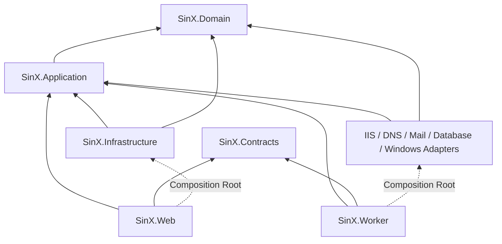
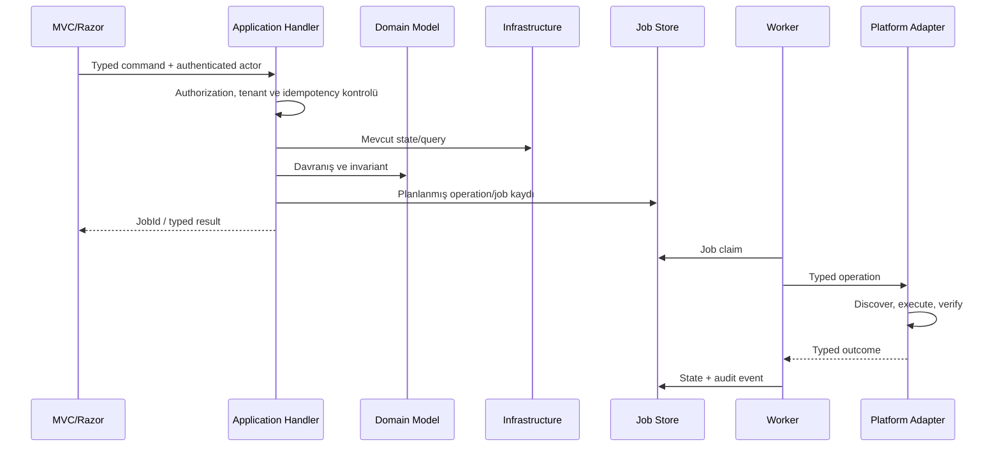

# SinX Proje Mimarisi ve Kodlama Standardı

> **Doküman sahibi:** `automation_api_specialist`  
> **Teknik koordinasyon:** `windows_server_engineer`, `web_security_specialist`

Bu doküman SinX kaynak kodunun bağlayıcı mimari standardıdır. Kodun hangi projeye ve klasöre yazılacağını, katman bağımlılıklarını, model türlerini, iş kurallarının yerini ve test sınırlarını tanımlar.

İlgili kaynaklar:

- [Agent çalışma standardı](../AGENTS.md)
- [Teknoloji ve altyapı kararları](technology-stack.md)
- [Uygulama dokümantasyonu](application-documentation.md)
- [Ekran ve menü dokümantasyonu](screen-menu.md)

## 1. Mimari ilkeler

> **Birincil agent:** `automation_api_specialist`  
> **Destek agent'ları:** `domain_hosting_specialist`, `web_security_specialist`

SinX, iki process halinde dağıtılan modüler monolittir:

- `SinX.Web`: düşük yetkili MVC/Razor UI, authentication, authorization ve sorgu koordinasyonu.
- `SinX.Worker`: ayrıcalıklı ve allowlist edilmiş sunucu operasyonları ile kalıcı job yürütme.

Kaynak kodda Clean Architecture bağımlılık yönü ile feature/vertical-slice organizasyonu birlikte kullanılır. Amaç her teknik ayrıntı için yeni katman üretmek değil; iş kurallarını UI, persistence ve Windows entegrasyonundan bağımsız tutmaktır.

Uygulanacak tasarım ilkeleri:

- **Separation of Concerns:** UI, use case, domain ve infrastructure sorumlulukları ayrılır.
- **Dependency Inversion:** İç katmanlar dış teknolojiye değil, dış katmanlar iç sözleşmelere bağımlıdır.
- **Single Responsibility:** Bir sınıfın tek değişim nedeni bulunur.
- **Explicit Dependencies:** Bağımlılıklar constructor üzerinden açıkça alınır; service locator kullanılmaz.
- **Encapsulation:** Aggregate invariant'ları yalnız aggregate metotlarıyla değişir.
- **Least Privilege:** Web ve domain kullanıcıları yalnız görevleri için gereken yetkiye sahiptir.
- **Fail Closed:** Yetki, tenant veya component durumu doğrulanamıyorsa işlem reddedilir.
- **Idempotency:** Provisioning komutları tekrar çalıştırıldığında deterministik sonuç üretir veya güvenli biçimde reddedilir.
- **YAGNI:** İlk sürümde gerekmeyen framework, event bus, generic abstraction ve plugin mekanizması eklenmez.

Microsoft'un Clean Architecture yaklaşımında iş modeli merkezdedir ve bağımlılıklar merkeze doğru akar: [Common web application architectures](https://learn.microsoft.com/en-us/dotnet/standard/modern-web-apps-azure-architecture/common-web-application-architectures).

## 2. Çözüm ve proje yapısı

> **Birincil agent:** `automation_api_specialist`  
> **Destek agent'ları:** `server_operations_specialist`, `windows_server_engineer`

```text
src/
├── SinX.sln
├── SinX.Domain/
├── SinX.Application/
├── SinX.Contracts/
├── SinX.Infrastructure/
├── SinX.Windows/
├── SinX.Iis/
├── SinX.Dns/
├── SinX.MailEnable/
├── SinX.Database.Abstractions/
├── SinX.Database.SqlServer/
├── SinX.Database.PostgreSql/
├── SinX.Database.MySql/
├── SinX.Database.MariaDb/
├── SinX.Web/
├── SinX.Worker/
└── tests/
    ├── SinX.Domain.UnitTests/
    ├── SinX.Application.UnitTests/
    ├── SinX.Infrastructure.IntegrationTests/
    ├── SinX.ContractTests/
    ├── SinX.ArchitectureTests/
    ├── SinX.WindowsVmTests/
    └── SinX.UiTests/
../AGENTS.md
../Directory.Build.props
├── Directory.Packages.props
├── global.json
└── .editorconfig
```

Başlangıçta bunların dışında proje oluşturulmaz. Yeni proje eklemek çözüm sınırını ve dependency graph'ını değiştirdiği için ADR gerektirir.

## 3. Bağımlılık yönü

> **Birincil agent:** `automation_api_specialist`



| Proje | Referans verebilir | Referans veremez |
|---|---|---|
| `SinX.Domain` | BCL ve zorunlu olmayan küçük domain primitives | Application, Infrastructure, Web, Worker, EF Core, ASP.NET Core, Windows/provider SDK'ları |
| `SinX.Application` | Domain | Web, Worker, Infrastructure implementation, EF Core, IIS/DNS/MailEnable SDK'ları |
| `SinX.Contracts` | BCL; gerekiyorsa kendi contract primitives | Domain entity, EF model, Web ViewModel, adapter implementation |
| `SinX.Infrastructure` | Application, Domain | Web view/controller |
| Provider/Windows adapter'ları | Application port'ları, Domain value type'ları, Contracts | Web view/controller ve başka provider implementation'ı |
| `SinX.Web` | Application, Contracts; yalnız composition root'ta registration extension'ları | Worker implementation, doğrudan Windows/IIS/DNS/DB yönetim API'leri |
| `SinX.Worker` | Application, Contracts ve adapter registration'ları | Web, Razor/MVC türleri |

`Program.cs` composition root'tur. Somut infrastructure sınıflarının görünmesi burada kabul edilir; controller veya application handler somut infrastructure sınıfı oluşturmamalıdır.

## 4. Katman sorumlulukları

> **Birincil agent:** `automation_api_specialist`  
> **Destek agent'ları:** İlgili özellik agent'ları

### 4.1 Domain katmanı

> **Birincil agent:** `domain_hosting_specialist`

`SinX.Domain` saf iş modelidir. İçerir:

- Aggregate root ve entity'ler
- Strongly typed ID ve value object'ler
- Her zaman geçerli olması gereken invariant'lar
- Domain service'leri
- Domain event'leri
- Domain error kodları

İçermez:

- EF Core attribute/configuration/migration
- Controller, DTO, ViewModel veya JSON annotation
- Windows/IIS/DNS/database SDK türü
- Dosya sistemi, ağ, saat veya random gibi doğrudan infrastructure erişimi

Örnek:

```text
SinX.Domain/
└── Domains/
    ├── Domain.cs
    ├── DomainId.cs
    ├── DomainName.cs
    ├── DomainStatus.cs
    ├── Events/
    │   └── DomainActivated.cs
    └── Errors/
        └── DomainErrors.cs
```

Aggregate property setter'ları dışarıya açılmaz. Durum değişikliği `Activate`, `AssignWebsite` veya `AttachDatabase` gibi niyet belirten metotlarla yapılır.

### 4.2 Application katmanı

> **Birincil agent:** `automation_api_specialist`  
> **Destek agent'ı:** `web_security_specialist`

`SinX.Application`, kullanıcının gerçekleştirdiği use case'leri orkestre eder. Feature-first yerleşim kullanılır:

```text
SinX.Application/
├── Abstractions/
│   ├── Persistence/
│   ├── Security/
│   ├── Jobs/
│   └── Platform/
└── Features/
    └── Domains/
        ├── CreateDomain/
        │   ├── CreateDomainCommand.cs
        │   ├── CreateDomainHandler.cs
        │   ├── CreateDomainResult.cs
        │   └── CreateDomainErrors.cs
        └── GetDomainDetails/
            ├── GetDomainDetailsQuery.cs
            ├── GetDomainDetailsHandler.cs
            └── DomainDetailsDto.cs
```

Kurallar:

- Command state değiştirir; Query state değiştirmez.
- Handler use case başına tek entry point'tir.
- Handler authorization scope, ön koşul, transaction ve job planını koordine eder.
- Handler infrastructure komutu veya PowerShell metni üretmez; typed port çağırır.
- Application DTO'ları use case'e özeldir; ortak dev DTO klasörü oluşturulmaz.
- MediatR/CQRS framework'ü zorunlu değildir. Açık handler sınıfları ve küçük interface'ler tercih edilir.

### 4.3 Contracts katmanı

> **Birincil agent:** `automation_api_specialist`

`SinX.Contracts` process sınırından geçen kararlı sözleşmeleri içerir:

- Web-to-Worker operation request/response
- Job progress/event mesajları
- Provider capability contract'ları
- Version ve error envelope'ları

Contract'lar davranış içermez, secret taşımaz ve domain entity serialize etmez. Breaking değişiklik yeni contract sürümü gerektirir.

### 4.4 Infrastructure katmanı

> **Birincil agent:** `automation_api_specialist`  
> **Destek agent'ları:** `web_security_specialist`, `monitoring_logging_specialist`

```text
SinX.Infrastructure/
├── Persistence/
│   ├── SinXDbContext.cs
│   ├── Configurations/
│   ├── Migrations/
│   └── Repositories/
├── Identity/
├── Secrets/
├── Jobs/
├── Audit/
└── DependencyInjection.cs
```

- Uygulamanın SQLite verisi burada yönetilir.
- EF Core mapping Fluent API ile `Configurations` altında tutulur; Domain entity'lerine EF attribute eklenmez.
- EF Core `DbContext` zaten Unit of Work/Repository davranışı sağladığından her entity için generic repository üretilmez.
- Custom repository yalnız aggregate persistence sınırı veya anlamlı query abstraction'ı gerektiğinde oluşturulur.
- Migration yalnız `SinX.Infrastructure` içinde bulunur ve code review olmadan otomatik üretilip production'a uygulanmaz.

### 4.5 Platform ve provider adapter'ları

> **Birincil agent:** `windows_server_engineer`  
> **Destek agent'ları:** İlgili provider agent'ları

Her adapter Application katmanındaki bir port'u uygular. Örnek yapı:

```text
SinX.Iis/
├── Discovery/
├── Planning/
├── Execution/
├── Verification/
├── Models/
└── DependencyInjection.cs
```

Adapter operasyonu dört aşamaya ayırır: mevcut durumu keşfet, değişiklik planı üret, allowlist edilmiş değişikliği uygula, sonucu doğrula. Rollback destek düzeyi planın parçasıdır.

Provider projeleri birbirine referans vermez. Ortak database sözleşmeleri `SinX.Database.Abstractions` içindedir; SQL Server'a özgü tür PostgreSQL projesine sızmaz.

### 4.6 Web katmanı

> **Birincil agent:** `web_server_specialist`  
> **Destek agent'ı:** `web_security_specialist`

```text
SinX.Web/
├── Controllers/
├── ViewModels/
├── Views/
│   ├── Shared/
│   └── <Feature>/
├── Authorization/
├── Filters/
├── Middleware/
├── Mapping/
├── Composition/
└── wwwroot/
```

- Controller ince tutulur; iş kuralı içermez.
- Input model/ViewModel yalnız UI içindir ve Domain entity olarak kullanılmaz.
- POST/PUT/DELETE benzeri state-changing form ve endpoint'lerde anti-forgery zorunludur.
- Başlangıç hostunda yalnız yönetici authentication sınırı bulunur; domain paneli yayımlanana kadar tenant authentication scheme/policy eklenmez.
- Domain kullanıcısının `domainId` değeri form, query string veya route'tan güven kaynağı olarak alınmaz; authenticated tenant context ile doğrulanır.
- Razor view veri erişimi, service resolution veya yetki kararı yapmaz.
- Gentelella sınıfları yalnız Views ve `wwwroot` içinde kalır.

### 4.7 Worker katmanı

> **Birincil agent:** `windows_server_engineer`  
> **Destek agent'ları:** `automation_api_specialist`, `web_security_specialist`

Worker yalnız versionlanmış typed contract ve allowlist edilmiş operation handler kabul eder. Serbest komut, script, SQL, registry path veya dosya yolu çalıştırmaz.

```text
SinX.Worker/
├── Endpoints/
├── Operations/
├── Authorization/
├── JobExecution/
├── Composition/
└── Program.cs
```

Worker her operasyon için actor, scope, hedef kaynak, idempotency key, plan özeti ve correlation ID doğrular.

## 5. Model sınıflandırması ve yerleşim kararı

> **Birincil agent:** `automation_api_specialist`  
> **Destek agent'ı:** `domain_hosting_specialist`

| Model türü | Amaç | Yer | Dışarı açılır mı? |
|---|---|---|---|
| Aggregate/Entity | İş kimliği, davranış ve invariant | Domain | Hayır |
| Value Object | Domain anlamı taşıyan immutable değer | Domain | Yalnız mapping sonrası |
| Command/Query | Bir use case girdisi | Application feature | Process dışına doğrudan değil |
| Application DTO/Result | Use case çıktısı | Application feature | Web/Worker mapping ile |
| Contract | API/IPC sınırı | Contracts | Evet, versionlanmış biçimde |
| ViewModel/InputModel | HTML form ve view | Web | Yalnız UI |
| Persistence configuration | EF mapping/index/conversion | Infrastructure | Hayır |
| Provider model | Haricî sistemin yerel modeli | İlgili adapter | Hayır |

`Model`, `Helper`, `Manager`, `Common`, `Utils` veya `Services` gibi anlamı belirsiz ortak klasörler açılmaz. Dosya use case ya da açık teknik sorumluluğuna göre adlandırılır.

## 6. İş kurallarının yerleştirilmesi

> **Birincil agent:** `domain_hosting_specialist`  
> **Destek agent'ları:** `automation_api_specialist`, `web_security_specialist`

Karar sırası:

1. Kural nesnenin her durumda geçerli olmasını mı sağlar? Domain aggregate/value object içine yazılır.
2. Kural bir use case akışını, actor yetkisini veya birden fazla aggregate koordinasyonunu mu yönetir? Application handler'a yazılır.
3. Kural Windows/IIS/provider capability veya sürüm ayrıntısına mı bağlıdır? Adapter içinde plan/validation olarak yazılır.
4. Kural yalnız form biçimi veya görüntüleme gereksinimi mi? Web InputModel/ViewModel içinde yazılır.
5. Kural veri bütünlüğünün son savunması mı? Infrastructure mapping/index/constraint ile ayrıca güçlendirilir; asıl iş kuralının yerine geçmez.

Örnekler:

| Kural | Doğru yer |
|---|---|
| Domain adı geçerli ve normalize edilmiş olmalı | `DomainName` value object |
| Pasif domain için database oluşturma job'u başlatılamaz | Application use-case handler + domain durumu |
| IIS kurulmadan website provisioning yapılamaz | IIS adapter capability/plan + Application ön koşulu |
| Domain kullanıcısı başka `domainId` göremez | Web authorization policy + Application tenant guard |
| Aynı normalized domain adı tekrar edemez | Application uniqueness check + SQLite unique index |
| SQL Server login yalnız hedef database'e map edilir | SQL Server adapter |

## 7. Use case akışı

> **Birincil agent:** `automation_api_specialist`



## 8. Hata ve sonuç modeli

> **Birincil agent:** `automation_api_specialist`  
> **Destek agent'ı:** `monitoring_logging_specialist`

- Beklenen hata: `Result<T>` ve kararlı error code.
- Beklenmeyen teknik hata: exception; global handler tarafından correlation ID ile loglanır.
- Domain error kodu örneği: `domain.name.invalid`.
- Application error kodu örneği: `domain.website.iis_not_ready`.
- Provider error kodu örneği: `sqlserver.login.creation_failed`.
- Kullanıcıya stack trace, command line, raw provider output veya secret gösterilmez.
- REST hata cevapları RFC 9457 Problem Details biçimine map edilir.
- MVC form hataları `ModelState` ile alan/genel hata olarak map edilir.

Exception normal kontrol akışı, validation veya bulunamadı sonucu için kullanılmaz.

## 9. Veri ve transaction kuralları

> **Birincil agent:** `automation_api_specialist`  
> **Destek agent'ları:** `database_integration_specialist`, `web_security_specialist`

- Uygulama metadata'sının tek doğruluk kaynağı SQLite'tır; Windows/provider gerçek durumu discovery ile ayrıca doğrulanır.
- Tek command içindeki metadata değişiklikleri tek transaction kullanır.
- Haricî sistem ve SQLite arasında dağıtık transaction varsayılmaz; job step, compensation ve reconciliation kullanılır.
- Her aggregate optimistic concurrency token taşır.
- Silme işlemlerinde bağlı kaynaklar için açık etki planı gerekir; cascade delete varsayılan değildir.
- Secret yerine `SecretReference` saklanır.
- Persisted tarih/saat UTC `DateTimeOffset` olarak saklanır.
- Migration ileri ve geri uyumluluk etkisiyle code review edilir; destructive migration backup ve açık onay gerektirir.

## 10. Güvenlik sınırları

> **Birincil agent:** `web_security_specialist`  
> **Destek agent'ları:** `windows_server_engineer`, `automation_api_specialist`

- Authentication kim olduğunu; authorization ne yapabildiğini belirler. İkisi aynı kontrol sayılmaz.
- UI'da menüyü gizlemek authorization değildir; backend policy ve use-case guard zorunludur.
- Domain scope, authenticated `ICurrentTenant` benzeri context üzerinden gelir.
- Web-to-Worker isteği actor, scope, operation type ve target resource içerir; Worker bunları yeniden doğrular.
- Path girdileri canonical root altında resolve edilir; traversal/reparse-point kontrolü yapılır.
- Provider secret'ları DPAPI/Data Protection ve ACL ile korunur; log/audit içinde redaction uygulanır.
- Dinamik PowerShell/SQL/shell string birleştirme yasaktır. Versionlanmış adapter operasyonu ve typed parametre kullanılır.
- State-changing MVC action'larında anti-forgery; API'lerde uygun CSRF/origin ve authentication kontrolleri uygulanır.

## 11. C# kod standardı

> **Birincil agent:** `automation_api_specialist`

- Namespace proje ve klasör yapısını izler.
- Dosya başına bir ana public type bulunur.
- Nullable reference types ve implicit usings açıktır.
- Class yalnız kalıtım amacı varsa açık bırakılır; diğer application/infrastructure sınıfları `sealed` olabilir.
- I/O yapan public async metot `CancellationToken` alır ve `Async` son eki kullanır.
- Blocking `.Result`, `.Wait()` ve fire-and-forget `Task` kullanılmaz.
- Doğrudan `DateTime.Now`, `DateTime.UtcNow`, rastgele global state veya static mutable collection kullanılmaz.
- Options yapılandırmaları başlangıçta validate edilir.
- Public contract ve karmaşık güvenlik sınırlarında XML documentation yazılır; açıklayıcı olmayan yorum yerine isimlendirme düzeltilir.
- `#pragma warning disable`, analyzer suppression ve `null!` yalnız gerekçeli, dar kapsamlı ve review edilebilir biçimde kullanılır.
- Magic string olarak provider, role, policy, route veya error code çoğaltılmaz; sahip olduğu modülde sabit/typed değer kullanılır.

## 12. Test standardı

> **Birincil agent:** `server_operations_specialist`  
> **Destek agent'ları:** `automation_api_specialist`, ilgili özellik agent'ı

| Test | Kapsam | Haricî bağımlılık |
|---|---|---|
| Domain unit | Invariant, value object, state transition | Yok |
| Application unit | Use case, authorization guard, error mapping | Port fake/stub |
| Infrastructure integration | Gerçek geçici SQLite, EF mapping/migration | Yerel geçici dosya |
| Contract | Web/Worker ve provider contract uyumu | Serializer/fixture |
| Architecture | Yasak proje/namespace dependency'leri | Reflection/build graph |
| Windows VM | IIS, DNS, account, service, firewall adapter'ı | Disposable Windows Server VM |
| UI/E2E | Route, authentication, tenant isolation, form ve job akışı | Playwright + test Worker |

Test isimleri davranışı belirtir:

```text
Method_WhenCondition_ShouldExpectedResult
```

Her güvenlik sınırı için en az bir negatif test bulunur. Özellikle başka domain erişimi, başka database erişimi, path traversal, yetkisiz Worker operation ve secret redaction test edilir.

## 13. Mimari karar kaydı

> **Birincil agent:** `automation_api_specialist`

Aşağıdakiler ADR gerektirir:

- Yeni proje veya process
- Yeni framework veya büyük NuGet bağımlılığı
- Katman dependency yönü değişikliği
- Yeni persistence teknolojisi
- Authentication/authorization modeli değişikliği
- IPC veya dış API contract'ında breaking değişiklik
- Güven sınırı ya da privileged operation kapsamı değişikliği

Dosya formatı:

```text
docs/adr/0001-short-decision-title.md
```

ADR; bağlam, karar, alternatifler, olumlu/olumsuz sonuçlar, güvenlik etkisi ve geri dönüş koşullarını içerir.

## 14. Definition of Done

> **Birincil agent:** `server_operations_specialist`  
> **Destek agent'ları:** `automation_api_specialist`, `web_security_specialist`

Bir değişiklik aşağıdakiler tamamlanmadan bitmiş sayılmaz:

- Kod doğru proje/feature klasöründedir ve dependency kuralını ihlal etmez.
- İş kuralı doğru katmandadır; controller/view/adapter içine sızmamıştır.
- Authorization, tenant scope, audit, idempotency ve secret etkileri değerlendirilmiştir.
- Başarı, validation, yetkisiz erişim ve önemli failure senaryoları test edilmiştir.
- Build warning üretmez; ilgili testler geçer.
- API/IPC değiştiyse contract ve uyumluluk testi güncellenmiştir.
- Kullanıcı davranışı veya mimari karar değiştiyse doküman/ADR güncellenmiştir.
- Windows üzerinde doğrulanamayan davranış açıkça belirtilmiş ve VM test planı yazılmıştır.
- Rollback/compensation davranışı tanımlanmıştır.

