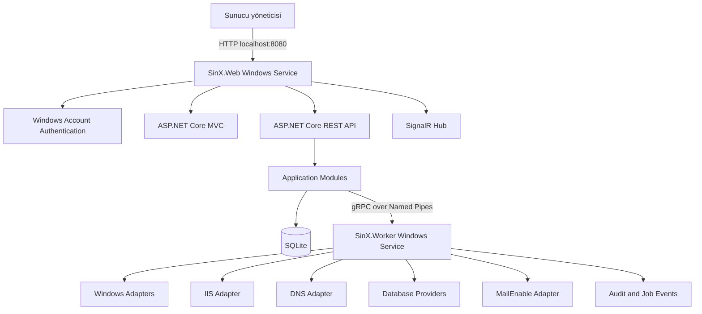

# SinX Teknoloji ve Altyapı Kararları

> **Doküman sahibi:** `automation_api_specialist`  
> **Teknik koordinasyon:** `windows_server_engineer`, `server_operations_specialist`

Bu doküman SinX uygulamasının teknoloji yığınını, process mimarisini, kaynak kod organizasyonunu, Windows entegrasyon yöntemlerini, veri saklama yaklaşımını ve dağıtım modelini tanımlar.

İlgili dokümanlar:

- [Proje Mimarisi ve Kodlama Standardı](project-architecture.md)
- [Uygulama Dokümantasyonu](application-documentation.md)
- [Ekran ve Menü Dokümantasyonu](screen-menu.md)

## 1. Teknoloji karar özeti

> **Birincil agent:** `automation_api_specialist`  
> **Destek agent'ları:** `windows_server_engineer`, `web_server_specialist`, `web_security_specialist`

| Katman | Seçilen teknoloji |
|---|---|
| Platform | Windows Server x64 |
| Backend | C# ve .NET 10 LTS |
| Web framework | ASP.NET Core 10 MVC ve REST API |
| Web sunucusu | Self-hosted Kestrel |
| Başlangıç endpoint'i | Yalnız HTTP `localhost:8080/TCP`; domain paneli henüz yayımlanmaz |
| Frontend | Server-rendered Razor Views/Pages, HTML5 ve vanilla JavaScript |
| UI sistemi | Gentelella v4 HTML admin template |
| UI varlıkları | Versionlanmış ve uygulamaya gömülü Gentelella CSS/JS çıktıları |
| Form doğrulama | ASP.NET Core Model Binding, DataAnnotations, ModelState ve HTML5 doğrulama |
| Yerelleştirme | Web katmanında `IStringLocalizer`, varsayılan/fallback `tr-TR`, izinli `en-US` |
| Gerçek zamanlı bildirim | ASP.NET Core SignalR |
| Süreçler arası iletişim | gRPC over Windows Named Pipes |
| Yerel uygulama veritabanı | SQLite ve EF Core 10 |
| Job altyapısı | SQLite üzerinde kalıcı özel job state machine |
| Windows entegrasyonu | .NET/Win32 API öncelikli; allowlist edilmiş PowerShell adapter'ları ikincil |
| Dış API | REST/JSON ve OpenAPI |
| Loglama | Microsoft.Extensions.Logging, JSON rolling file ve Windows Event Log |
| Secret koruması | Windows DPAPI, ACL ve ASP.NET Core Data Protection |
| Paketleme | Self-contained `win-x64` yayın ve WiX tabanlı MSI |
| UI testleri | Playwright |
| Backend testleri | xUnit |
| PowerShell testleri | Pester |

Ana sürüm `.NET 10 LTS` olarak sabitlenir. .NET 11 preview veya STS sürümleri başlangıç mimarisinde kullanılmaz. Microsoft, .NET 10'u aktif LTS sürümü olarak listeler: [.NET destek politikası](https://dotnet.microsoft.com/en-us/platform/support/policy/dotnet-core).

Gentelella yalnızca görünüm katmanıdır; authentication, authorization, session, veri erişimi ve iş kuralları ASP.NET Core tarafından uygulanır. Gentelella v4 MIT lisanslıdır ve kişisel/ticari kullanım için ücretsizdir: [Gentelella kaynak kodu ve lisansı](https://github.com/ColorlibHQ/gentelella).

## 2. Mimari yaklaşım

> **Birincil agent:** `automation_api_specialist`  
> **Destek agent'ları:** `server_operations_specialist`, `windows_server_engineer`

Başlangıç mimarisi mikroservis değildir. Tek repository ve tek ürün paketi içinde çalışan, process sınırlarıyla güvenlik ayrımı yapan modüler monolit kullanılır.



İki uzun ömürlü process bulunur:

1. `SinX.Web`: Web UI, HTTP API, login, session, validation ve salt-okunur sorgu koordinasyonu.
2. `SinX.Worker`: Yönetici yetkisi gerektiren allowlist edilmiş operasyonlar, component discovery ve job yürütme.

ASP.NET Core uygulaması IIS'e bağımlı olmadan Windows Service olarak host edilir. Bu kullanım Microsoft tarafından desteklenir: [ASP.NET Core'u Windows Service olarak çalıştırma](https://learn.microsoft.com/en-us/aspnet/core/host-and-deploy/windows-service?view=aspnetcore-10.0).

## 3. Neden .NET 10 ve ASP.NET Core

> **Birincil agent:** `windows_server_engineer`  
> **Destek agent'ları:** `automation_api_specialist`, `web_server_specialist`

- Windows Service, Event Log, certificate store, DPAPI, named pipe ve native Windows API entegrasyonu güçlüdür.
- IIS, Windows servisleri, kullanıcı/grup, certificate ve process yönetimi için C#/.NET doğal seçimdir.
- Self-contained yayın sayesinde hedef sunucuda ayrıca .NET Runtime kurulu olması zorunlu değildir.
- Kestrel, IIS kurulmadan yalnız `localhost:8080/TCP` portunda çalışabilir.
- ASP.NET Core Web API, SignalR, authentication, authorization, rate limiting ve OpenAPI ihtiyaçlarını tek platformda karşılar.
- EF Core ile SQLite uygulama verisi tip güvenli şekilde yönetilebilir.

## 4. Web arayüzü yaklaşımı

> **Birincil agent:** `web_server_specialist`  
> **Destek agent'ları:** `web_security_specialist`, `monitoring_logging_specialist`

Web arayüzü ASP.NET Core MVC tarafından sunucuda render edilir. Ayrı bir SPA, Node.js uygulaması, Razor Pages veya Blazor katmanı bulunmaz. Gentelella v4'ün HTML düzeni Razor layout, partial ve view'lara bölünür.

Web arayüzü kararları:

- Ana kabuk `Views/Shared/_Layout.cshtml` içinde tanımlanır.
- Sidebar, header, footer, breadcrumb ve bildirim alanları partial view olarak ayrılır.
- Setup, login, Identity ve yönetim ekranları MVC controller/view yapısıyla geliştirilir.
- Formlar strongly typed view model, Model Binding, DataAnnotations ve `ModelState` ile sunucu tarafında doğrulanır.
- İstemci doğrulaması yardımcıdır; hiçbir güvenlik veya iş kuralı yalnızca tarayıcı JavaScript'ine bırakılmaz.
- Küçük etkileşimler vanilla JavaScript ve Fetch API ile yapılır.
- SignalR yalnızca job ilerlemesi, servis durumu ve uyarı güncellemelerinde kullanılır.
- Sunucu ve domain kapsamı ASP.NET Core route, authentication scheme ve authorization policy'leriyle ayrılır.
- Kültür seçimi yalnız Web'in allowlist edilmiş culture cookie'sinden okunur; route, query string, API/IPC contract veya domain model kültür kaynağı değildir.
- Erişilebilirlik hedefi WCAG 2.2 AA'dır.

Gentelella'nın versionlanmış üretim CSS/JS çıktıları `SinX.Web/wwwroot/vendor/gentelella` altında uygulamayla birlikte dağıtılır. CDN kullanılmaz. Vite ve Node.js standart SinX build veya production çalışması için zorunlu değildir; tema kaynakları yeniden derlenecekse yalnızca kontrollü UI asset bakım sürecinde kullanılır ve üretilen dosyalar repository'ye alınır.

Tema entegrasyon kuralları:

- Örnek kullanıcılar, mock veriler, demo endpoint'leri ve kullanılmayan örnek sayfalar production paketine alınmaz.
- Font, ikon, resim, CSS ve JavaScript dosyaları haricî kaynaktan çağrılmaz; gerekli varlıklar yerel sunulur.
- Gentelella'nın PWA/service worker özelliği yönetim panelinde etkinleştirilmez; kimliği doğrulanmış yönetim ekranları offline cache'e yazılmaz.
- Yalnızca kullanılan üçüncü taraf plugin'ler pakete alınır ve her biri lisans envanterine kaydedilir.
- Gentelella sürümü, upstream kaynak URL'si ve dağıtılan dosyaların SHA-256 değerleri asset manifestinde tutulur.
- Tema HTML'i yalnızca sunum katmanıdır; controller, application service veya authorization kuralları tema koduna taşınmaz.

Önerilen route yapısı:

```text
/setup
/login
/dashboard
/server/*
/domains
/domains/:domainId/*
/jobs/:jobId
/audit
/settings
```

## 5. Backend modüler monolit yapısı

> **Birincil agent:** `automation_api_specialist`  
> **Destek agent'ları:** `server_operations_specialist`, `domain_hosting_specialist`

Kod tabanı feature/module sınırlarına ayrılır. Katman isimleri iş kurallarının infrastructure ayrıntılarından bağımsız kalmasını sağlamalıdır. Klasör yerleşimi, dependency yönü, model sınıflandırması, iş kuralı yerleşimi ve test standardı için bağlayıcı kaynak [Proje Mimarisi ve Kodlama Standardı](project-architecture.md) dokümanıdır.

```text
src/
├── SinX.Domain
├── SinX.Application
├── SinX.Contracts
├── SinX.Infrastructure
├── SinX.Windows
├── SinX.Iis
├── SinX.Dns
├── SinX.MailEnable
├── SinX.Database.Abstractions
├── SinX.Database.SqlServer
├── SinX.Database.PostgreSql
├── SinX.Database.MySql
├── SinX.Database.MariaDb
├── SinX.Web
│   ├── Controllers
│   ├── ViewModels
│   ├── Views
│   └── wwwroot/vendor/gentelella
└── SinX.Worker

src/tests/
├── SinX.Domain.UnitTests
├── SinX.Application.UnitTests
├── SinX.Infrastructure.IntegrationTests
├── SinX.ContractTests
├── SinX.ArchitectureTests
├── SinX.WindowsVmTests
└── SinX.UiTests
```

Feature modülleri birbirinin infrastructure sınıflarına doğrudan erişmez. Paylaşılan sözleşmeler `SinX.Contracts` ve ilgili abstraction projelerinde tutulur.

MediatR veya kapsamlı bir CQRS framework'ü başlangıç için zorunlu değildir. Açık application service ve handler sınıfları kullanılır; gereksiz framework bağımlılığı oluşturulmaz.

## 6. Web ve Worker ayrımı

> **Birincil agent:** `windows_server_engineer`  
> **Destek agent'ları:** `web_security_specialist`, `automation_api_specialist`

### 6.1 SinX.Web

> **Birincil agent:** `web_server_specialist`  
> **Destek agent'ı:** `web_security_specialist`

- Düşük yetkili Windows service identity ile çalışır.
- Başlangıçta yalnız HTTP `localhost:8080` üzerinde Setup/Login yönetici endpoint'lerini açar.
- Domain paneli endpoint'i henüz yayımlanmaz; bu nedenle tenant route veya ayrı domain authentication scheme'i bu kalemde bulunmaz.
- Domain endpoint'inde kimlik doğrulanan hesabın `domainId` kapsamı backend authorization policy ve sorgu filtreleriyle zorunlu tutulur.
- Razor Views/Pages, Gentelella statik varlıkları ve REST API'yi sunar.
- Kullanıcı girdisini doğrular.
- Ham PowerShell, SQL, shell veya installer argümanını Worker'a iletmez.
- Kullanıcının parolasını kalıcı olarak saklamaz.
- Yetkili operasyonları tip güvenli gRPC contract'larına dönüştürür.

### 6.2 SinX.Worker

> **Birincil agent:** `windows_server_engineer`  
> **Destek agent'ları:** `server_operations_specialist`, `automation_api_specialist`

- Kurulumda oluşturulan yerel Administrators hesabıyla Windows Service olarak çalışır.
- İnternet veya TCP üzerinden doğrudan dinleme yapmaz.
- Yalnızca ACL ile korunan named pipe endpoint'ini açar.
- Desteklenen operasyonları explicit handler allowlist'i üzerinden yürütür.
- Job state transition, timeout, cancellation, reboot continuation ve doğrulama üretir.
- Hassas process output'unu loglamadan önce maskeler.

## 7. Süreçler arası iletişim

> **Birincil agent:** `automation_api_specialist`  
> **Destek agent'ı:** `web_security_specialist`

Web ve Worker arasında gRPC over Windows Named Pipes kullanılır. ASP.NET Core/Kestrel için named-pipe transport ve pipe security desteği mevcuttur: [gRPC ve Named Pipes ile IPC](https://learn.microsoft.com/en-us/aspnet/core/grpc/interprocess-namedpipes).

Geçit yalnız versioned typed envelope kabul eder: contract version, allowlist operation, operation ID, actor/bootstrap, server scope/target, correlation ID ve opaque secret reference. Parola IPC, audit, log veya kalıcı state içine girmez; Worker referansı bir kez ve TTL içinde tüketir. Named-pipe host/ACL installer tarafından sağlanmadığında Web ayrıcalıklı iş yürütmez ve request'i reddeder.

IPC kuralları:

- Pipe yalnızca yerel makinede açılır.
- ACL yalnızca `SinX.Web` service identity ve `SinX.Worker` hesabına izin verir.
- Contract'lar versioned protobuf ile tanımlanır.
- Her istek `operationId`, `actorSid`, `scopeType`, `scopeId` ve correlation ID taşır.
- Worker, Web tarafından gönderilen path, command veya script metnini doğrudan çalıştırmaz.
- Büyük log çıktıları gRPC mesajına gömülmez; güvenli job event storage üzerinden sayfalanır.

## 8. API yaklaşımı

> **Birincil agent:** `automation_api_specialist`  
> **Destek agent'ları:** `web_security_specialist`, `domain_hosting_specialist`

Dış web API REST/JSON olarak geliştirilir ve OpenAPI sözleşmesi üretilir.

Kurallar:

- Route'lar `/api/v1` ile versionlanır.
- Sunucu ve domain kapsamı route seviyesinde ayrılır.
- Domain adı yerine değişmez `domainId` kullanılır.
- Database çağrıları `providerId` ve `instanceId` taşır.
- Değişiklik işlemleri doğrudan uzun HTTP request'i içinde çalıştırılmaz; job oluşturur ve `202 Accepted` döndürür.
- Idempotent create/update operasyonları request ID veya idempotency key kabul eder.
- Hatalar RFC 9457 Problem Details biçiminde döndürülür.
- Liste endpoint'leri pagination, filter ve sort sözleşmesi kullanır.

Örnek:

```text
POST /api/v1/server/components/iis/install
POST /api/v1/server/database-providers/mysql/install
POST /api/v1/domains/{domainId}/databases
GET  /api/v1/jobs/{jobId}
```

## 9. Kimlik doğrulama ve oturum

> **Birincil agent:** `web_security_specialist`  
> **Destek agent'ı:** `windows_server_engineer`

- Kurulumda oluşturulan yerel Windows hesabı kullanılır.
- Login sırasında credential, Windows `LogonUserW` API'si ile doğrulanır: [LogonUserW](https://learn.microsoft.com/en-us/windows/win32/api/winbase/nf-winbase-logonuserw).
- Kabul edilen Windows SID kurulum sırasında sabitlenir; başka Administrator hesapları otomatik erişim kazanmaz.
- Başarılı login sonrasında ASP.NET Core cookie session oluşturulur.
- Cookie `HttpOnly` ve `SameSite=Strict` olur; HTTPS etkinse `Secure` eklenir.
- Login rate limit, lockout koruması, CSRF koruması ve kısa session timeout uygulanır.
- HTTP desteklenir ancak credential ve session trafiğini şifrelemediği UI'da açıkça belirtilir.

### 9.1 Domain panel hesabı

> **Birincil agent:** `web_security_specialist`  
> **Destek agent'ları:** `domain_hosting_specialist`, `automation_api_specialist`

- Domain oluşturulurken alınan kullanıcı adı ve parola yalnızca gelecekte yayımlanacak domain paneli içindir.
- Parola adaptif password hash olarak saklanır; Application Pool, FTP veya database parolası olarak tekrar kullanılmaz.
- Oturum claim'leri değişmez `domainId` taşır ve tüm repository/command erişimleri bu kapsamı zorunlu uygular.
- Host adı ile bulunan domain ve oturumdaki `domainId` uyuşmazsa istek reddedilir.
- Domain hesabı gelecekteki yönetici endpoint'inde geçerli değildir.

## 10. Yerel uygulama verisi

> **Birincil agent:** `automation_api_specialist`  
> **Destek agent'ları:** `web_security_specialist`, `monitoring_logging_specialist`

SinX kendi çalışması için yönettiği SQL Server, PostgreSQL, MySQL veya MariaDB instance'larına bağımlı olmamalıdır. Uygulama durumu embedded SQLite veritabanında tutulur.

SQLite'ta saklanacak temel veriler:

- Kurulum durumu ve oluşturulan hesabın SID'si
- Domain metadata ve resource ilişkileri
- Component/provider discovery snapshot'ları
- Job state ve event'leri
- Audit kayıtları
- Uygulama ayarları
- Şifrelenmiş secret reference'ları
- Schema migration bilgisi

EF Core SQLite provider kullanılır: [EF Core SQLite provider](https://learn.microsoft.com/en-us/ef/core/providers/sqlite/).

Kurallar:

- WAL modu ve uygun busy timeout kullanılır.
- Tek Writer yaklaşımıyla job/audit yazma çakışmaları kontrol edilir.
- SQLite dosyası `C:\ProgramData\SinX\Data` altında tutulur.
- ACL yalnızca SinX servis hesaplarına ve SYSTEM'e erişim verir.
- Database backup'ı uygulama güncellemesi ve kritik migration öncesinde alınır.
- Uygulama database'i müşteri/domain database backup'larına karıştırılmaz.

## 11. Secret ve anahtar yönetimi

> **Birincil agent:** `web_security_specialist`  
> **Destek agent'ı:** `windows_server_engineer`

- Düz metin parola, private key, token veya connection string saklanmaz.
- ASP.NET Core Data Protection key ring `C:\ProgramData\SinX\Keys` altında ACL ile korunur.
- Diskte tutulması gereken secret'lar Windows DPAPI ile şifrelenir.
- Worker'ın kullanacağı servis parolası mümkün olduğunda Service Control Manager tarafından yönetilir; uygulama veritabanında kopyası tutulmaz.
- Log, audit ve exception çıktılarında secret redaction uygulanır.
- Provider credential'ları opaque secret ID üzerinden referanslanır.

## 12. Windows entegrasyon stratejisi

> **Birincil agent:** `windows_server_engineer`  
> **Destek agent'ları:** `server_operations_specialist`, `web_security_specialist`

Öncelik sırası:

1. Desteklenen .NET veya Win32 API
2. Resmî yönetim API'si/SDK
3. CIM/WMI
4. Allowlist edilmiş statik PowerShell adapter'ı

İlk adapter eşleştirmesi:

| Alan | Tercih edilen entegrasyon |
|---|---|
| Windows servisleri | Service Control Manager/.NET ServiceController |
| Yerel kullanıcı ve gruplar | Windows account API ve gerektiğinde LocalAccounts PowerShell |
| Windows rolleri | ServerManager PowerShell module |
| IIS | Microsoft.Web.Administration ve gerekli durumda AppCmd |
| DNS | DnsServer PowerShell/CIM |
| Firewall | NetSecurity PowerShell/CIM |
| Scheduled Tasks | Task Scheduler API/PowerShell |
| Certificate store | .NET X509Store |
| Event Log | System.Diagnostics.Eventing.Reader |
| Disk ve volume | Storage CIM/PowerShell |
| MailEnable | Desteklenen MailEnable yönetim API/utility adapter'ı |

PowerShell ilkeleri:

- Kullanıcıdan ham script veya command kabul edilmez.
- Scriptler ürünle birlikte versionlanmış ve hash'i doğrulanan kaynaklardır.
- Parametreler strongly typed contract'tan üretilir.
- `-NoProfile` ve non-interactive çalışma kullanılır.
- Timeout, cancellation, exit code, stdout/stderr boyut limiti uygulanır.
- Mümkünse JSON veya tanımlı schema ile makine-okunur çıktı alınır.

## 13. Database provider altyapısı

> **Birincil agent:** `database_integration_specialist`  
> **Destek agent'ları:** `sql_server_engineer`, `postgresql_engineer` ve provider uzmanları

Core katman belirli database ürününe referans vermez. Her ürün `IDatabaseProvider` sözleşmesini uygular.

```text
IDatabaseProvider
├── GetMetadata
├── Detect
├── GetHealth
├── PlanInstall
├── Install
├── Start / Stop / Repair
├── DiscoverInstances
├── CreateDatabase / DeleteDatabase
├── CreatePrincipal / DeletePrincipal
├── GrantPermissions
├── Backup / Restore
├── BuildConnectionMetadata
└── Validate
```

İlk provider projeleri:

- `SinX.Database.SqlServer`
- `SinX.Database.PostgreSql`
- `SinX.Database.MySql`
- `SinX.Database.MariaDb`

Her provider kendi client library, installer manifest, version compatibility, health check ve hata eşlemesini izole eder. MySQL ve MariaDB benzer protokol kullansa bile ayrı provider ID, capability ve lifecycle tanımına sahip olur.

Runtime'da rastgele üçüncü taraf DLL yükleyen plugin sistemi ilk sürümde kullanılmaz. Provider'lar build-time DI registration ile ürüne dahil edilir. Bu yaklaşım supply-chain ve ayrıcalıklı kod çalıştırma riskini azaltır.

### 13.1 Domain, pool ve database principal binding

> **Birincil agent:** `database_integration_specialist`  
> **Destek agent'ları:** `sql_server_engineer`, `postgresql_engineer`, `web_server_specialist`, `web_security_specialist`

Website'in database erişimi aşağıdaki ilişkiyle kayıt altına alınır:

```text
DatabasePrincipalBinding
├── domainId
├── websiteId
├── applicationPoolName
├── providerId
├── instanceId
├── databaseId
├── authenticationMode: WindowsIntegrated | NativeCredential
├── principalId
└── secretReference: yalnızca NativeCredential için
```

`applicationPoolName` ile database principal arasındaki ilişki SinX metadata'sında açıkça tutulur. Bir binding yalnızca tek domain ve tek hedef database için yetki üretir. Provider adapter'ı oluşturma sonrasında hedef database'e olumlu erişimi ve başka bir domain database'ine erişimin reddedildiğini doğrulamalıdır.

| Provider | Varsayılan kimlik doğrulama | Oluşturulacak principal ve yetki sınırı |
|---|---|---|
| Yerel SQL Server | `WindowsIntegrated` | Login: `[IIS APPPOOL\SinX-Pool-<domainId>]`; yalnızca hedef database içinde user oluşturulur ve gereken en düşük roller/izinler verilir. Server role verilmez. |
| PostgreSQL | `NativeCredential` | Domaine özel `LOGIN` role; yalnızca hedef database için `CONNECT`, gerekli schema/table izinleri. Diğer database'lerde yetki yoktur. |
| MySQL | `NativeCredential` | Domaine özel `'user'@'localhost'`; yalnızca hedef `database.*` için gerekli grant'ler. Global grant yoktur. |
| MariaDB | `NativeCredential` | Domaine özel `'user'@'localhost'`; yalnızca hedef `database.*` için gerekli grant'ler. Global grant yoktur. |

SQL Server aynı Windows sunucusunda çalışırken IIS Application Pool sanal hesabı doğrudan Windows login olarak kullanılabilir. SQL Server uzak sunucudaysa sanal hesap ağ üzerinde makine hesabı olarak görünebileceğinden pool bazında güvenli ayrım garanti edilmez; bu durumda domaine özel native SQL login veya yönetilen domain service identity gerekir.

PostgreSQL, MySQL ve MariaDB için `ApplicationPoolIdentity` doğrudan ve taşınabilir bir login mekanizması değildir. Bu provider'larda SinX, pool/domain binding'ine ait güçlü rastgele parola üretir, credential'ı DPAPI ile korur ve bağlantı bilgisini yalnızca ilgili Application Pool identity'nin okuyabileceği ACL kapsamına yazar. Kullanıcının domain panel parolası database parolası olarak kullanılmaz.

Yerel SQL Server provisioning sırası şöyledir:

1. `[IIS APPPOOL\SinX-Pool-<domainId>]` Windows login'i oluşturulur.
2. Yalnızca hedef database içinde bu login'e bağlı user oluşturulur.
3. Uygulamanın ihtiyacına göre özel en-az-yetkili rol veya gerekli `SELECT`, `INSERT`, `UPDATE`, `DELETE` ve `EXECUTE` izinleri verilir; varsayılan olarak `sysadmin`, server role veya `db_owner` verilmez.
4. Başka domain database'lerinde user mapping oluşturulmaz; gerektiğinde database görünürlüğü de sınırlandırılır.
5. Pool kimliğiyle hedef database bağlantısının başarılı, başka bir domain database bağlantısının başarısız olduğu integration test ile doğrulanır.

Application Pool adı kimliğin parçasıdır; bu nedenle pool yeniden adlandırılmaz. Zorunlu ad değişikliğinde eski login/user ve secret binding geri alınır, yeni kimlik atomik bir job ile hazırlanır. Domain silme, database atamasını kaldırma veya provider değiştirme işlemleri de eski principal yetkilerini ve connection secret'ını iptal etmelidir.

### 13.2 FTP kimliği

> **Birincil agent:** `file_deployment_specialist`  
> **Destek agent'ları:** `windows_server_engineer`, `web_security_specialist`

- FTP erişimi domain oluşturma sırasında isteğe bağlıdır.
- Ayrı bir non-admin yerel Windows hesabı ve ayrı parola oluşturulur.
- Hesap yalnızca domain FTP/document root dizininde gerekli NTFS izinlerini alır.
- Application Pool identity, domain panel hesabı veya database principal FTP için tekrar kullanılmaz.
- RDP, konsol ve service logon hakları verilmez; IIS FTP User Isolation uygulanır.

## 14. Job motoru

> **Birincil agent:** `automation_api_specialist`  
> **Destek agent'ları:** `server_operations_specialist`, `monitoring_logging_specialist`

Hangfire gibi genel job framework'leri başlangıçta zorunlu değildir. SinX; reboot continuation, component state, doğrulama ve rollback ihtiyaçları nedeniyle kendi küçük, kalıcı job state machine'ini kullanır.

Temel tablolar:

```text
Jobs
JobSteps
JobEvents
JobLocks
JobArtifacts
AuditEvents
```

Kurallar:

- Her state transition transaction içinde kaydedilir.
- Aynı kaynak üzerinde çakışan job'lar resource lock ile engellenir.
- Reboot öncesi resume token/state diske yazılır.
- Worker yeniden başladığında yarım job'ları deterministik biçimde değerlendirir.
- Cancellation yalnızca step'in desteklediği güvenli noktada uygulanır.
- Rollback her işlem için varmış gibi varsayılmaz; destek düzeyi planda belirtilir.

## 15. Loglama, monitoring ve audit

> **Birincil agent:** `monitoring_logging_specialist`  
> **Destek agent'ları:** `web_security_specialist`, `server_operations_specialist`

- Structured JSON application log
- Windows Event Log'a servis başlangıç/durma ve kritik hata kaydı
- Correlation ID ve job ID
- Rolling file ve retention
- SignalR ile canlı job event'leri
- Audit kayıtlarında actor SID, scope, target, before/after ve result
- Secret ve kişisel veri redaction
- Uygulama health endpoint'leri

OpenTelemetry için abstraction korunur; ilk sürümde dış collector zorunlu değildir.

## 16. Paketleme ve kurulum

> **Birincil agent:** `server_operations_specialist`  
> **Destek agent'ları:** `windows_server_engineer`, `web_security_specialist`

Dağıtım paketi WiX ile üretilen imzalı MSI olmalıdır.

MSI görevleri:

- `C:\Program Files\SinX` altına salt-okunur program dosyaları
- `C:\ProgramData\SinX` altında data, keys, logs ve job artifacts dizinleri
- `SinX.Web` ve `SinX.Worker` Windows Service kayıtları
- Başlangıçta dış erişim açılmaz; yalnız `localhost:8080/TCP` Kestrel binding'i kullanılır.
- Gerekli klasör ve named pipe ACL'leri
- Uninstall ve repair kayıtları
- Event Log source kaydı
- Gentelella ve kullanılan üçüncü taraf UI bileşenlerinin lisans bildirimleri

.NET uygulaması `win-x64` self-contained olarak publish edilir. Başlangıçta single-file yayın zorunlu değildir; native ve provider bağımlılıklarının teşhisi için klasör tabanlı self-contained paket tercih edilir.

Installer ve binary'ler code-signing sertifikasıyla imzalanmalıdır. İndirilen üçüncü taraf installer'lar allowlist URL, publisher/signature ve SHA-256 doğrulamasından geçmelidir.

## 17. Test altyapısı

> **Birincil agent:** `server_operations_specialist`  
> **Destek agent'ları:** İlgili bileşen agent'ları

| Test türü | Teknoloji ve ortam |
|---|---|
| Unit | xUnit, saf domain/application testleri |
| API integration | ASP.NET Core TestServer/WebApplicationFactory |
| SQLite integration | Geçici gerçek SQLite dosyası |
| Provider contract | Her `IDatabaseProvider` için ortak contract test suite |
| Windows adapter | Disposable Windows Server VM |
| PowerShell | Pester ve fixture tabanlı script testleri |
| MVC/Razor UI integration | WebApplicationFactory ile route, authorization, form ve HTML smoke testleri |
| End-to-end | Playwright ile gerçek Web + test Worker |
| Installer | Temiz Windows Server VM üzerinde install/upgrade/repair/uninstall |

Windows rolleri, IIS, DNS ve servis hesabı davranışı Linux container üzerinde doğrulanmış sayılmaz. Bu testler snapshot'tan döndürülebilen Windows Server VM'lerinde yürütülmelidir.

## 18. Sürüm ve bağımlılık politikası

> **Birincil agent:** `server_operations_specialist`  
> **Destek agent'ları:** `web_security_specialist`, `automation_api_specialist`

- .NET SDK `global.json` ile patch hattına sabitlenir.
- NuGet lock dosyaları repository'ye alınır.
- Production build yalnızca kilitlenmiş NuGet bağımlılıklarını ve repository'deki versionlanmış Gentelella varlıklarını kullanır.
- Gentelella sürümü asset manifestinde sabitlenir; upstream değişiklikler otomatik alınmaz.
- Dependabot/Renovate benzeri otomasyon öneri üretir; otomatik production deploy yapmaz.
- Framework major yükseltmeleri ayrı migration ve regression planı gerektirir.
- Preview paketler production dependency olarak kullanılmaz.
- Provider connector sürümleri provider modülünde izole edilir.
- Kritik güvenlik güncellemeleri normal feature sürümünden bağımsız yayınlanabilir.

## 19. Bilinçli olarak seçilmeyen yaklaşımlar

> **Birincil agent:** `automation_api_specialist`  
> **Destek agent'ları:** `windows_server_engineer`, `server_operations_specialist`

| Yaklaşım | Başlangıçta seçilmeme nedeni |
|---|---|
| Uygulamayı IIS altında host etmek | IIS henüz kurulu değilken uygulamanın çalışması gerekir |
| Electron masaüstü uygulaması | Ürün internetten erişilen web panelidir; ek Chromium runtime gereksizdir |
| Microservice mimarisi | Tek sunuculu ürün için deployment ve operasyon karmaşıklığı getirir |
| SQL Server'ı uygulama verisi için zorunlu tutmak | Uygulama yönettiği database provider'larından bağımsız başlamalıdır |
| Runtime DLL plugin yükleme | Ayrıcalıklı process içinde supply-chain ve güven sınırı riski oluşturur |
| Ham PowerShell terminali | Kullanıcı girdisini yönetici yetkisiyle çalıştırma riski oluşturur |
| React/Vue/Angular SPA | İkinci bir frontend toolchain ve istemci state katmanı gerektirir; ürün için server-rendered HTML yeterlidir |
| Blazor | İhtiyaç duyulan arayüz MVC/Razor ve hazır HTML tema ile karşılandığından ek component modeli kullanılmaz |
| AdminLTE ASP.NET Core paketi | Resmî entegrasyon uygun olsa da UI'nın framework paketine bağlanmaması için versionlanmış saf HTML/CSS/JS tema varlıkları tercih edilmiştir |
| Kubernetes/container-first deployment | Windows host yönetimi, servis hesabı ve yerel OS API erişimiyle uyumlu değildir |

## 20. İlk teknik uygulama sırası

> **Birincil agent:** `server_operations_specialist`  
> **Destek agent'ları:** Her adımın ilgili uzman agent'ı

1. Solution yapısı, build standardı ve ortak contracts
2. `SinX.Web` Windows Service ve yalnız `localhost:8080` Kestrel endpoint'i
3. Gentelella HTML kabuğunun MVC/Razor layout ve partial view'lara dönüştürülmesi; login ve setup ekranları
4. SQLite/EF Core migration altyapısı
5. Setup state ve yerel Windows hesabı oluşturma
6. Windows credential doğrulama ve cookie session
7. `SinX.Worker` Windows Service
8. gRPC over Named Pipes ve ACL
9. Kalıcı job state machine ve audit
10. Component discovery abstraction
11. IIS ve DNS adapter'ları
12. Domain aggregate ve domain ekranları
13. Database provider abstraction ve dört başlangıç provider'ı
14. Domain paneli endpoint'i, domain hesabı ve tenant authorization testleri (ayrı endpoint kararı verildiğinde)
15. Application Pool/database principal binding ve çapraz-domain negatif erişim testleri
16. MailEnable Standard adapter'ı
17. Installer MSI, upgrade ve repair akışları
18. Windows Server VM integration test pipeline'ı

## 21. Teknoloji kabul kriterleri

> **Birincil agent:** `automation_api_specialist`  
> **Destek agent'ları:** `windows_server_engineer`, `web_security_specialist`, `server_operations_specialist`

- Uygulama IIS ve harici database olmadan başlayabilmelidir.
- Standart build ve production sunucuda Node.js veya Vite gerekmemelidir.
- Uygulama haricî CDN olmadan tüm Gentelella CSS/JS/font varlıklarını yerel sunabilmelidir.
- Web ve Worker farklı Windows identities ile çalışabilmelidir.
- Worker internetten erişilebilir TCP endpoint'i açmamalıdır.
- Web-to-Worker iletişimi ACL kontrollü named pipe üzerinden gerçekleşmelidir.
- Hiçbir API ham PowerShell, SQL veya shell komutu kabul etmemelidir.
- Job'lar process ve sunucu restartı sonrasında güvenli şekilde değerlendirilebilmelidir.
- SQLite bozulması ve migration hatası için backup/restore prosedürü bulunmalıdır.
- Database provider eklemek core/domain sözleşmelerini değiştirmemelidir.
- Domain paneli henüz yayımlanmadığından başlangıç hostu yalnız yönetici Setup/Login rotalarını sunmalıdır; tenant endpoint'i eklendiğinde domain kullanıcısı yalnız kendi `domainId` kaynaklarına erişebilmelidir.
- Her website ayrı Application Pool kullanmalı; database principal'ı yalnızca atanmış database'e erişmeli ve çapraz-domain erişim testi başarısız olmalıdır.
- FTP hesabı oluşturulduğunda non-admin olmalı ve başka domain dizinine erişememelidir.
- MSI temiz kurulum, upgrade, repair ve uninstall testlerinden geçmelidir.
